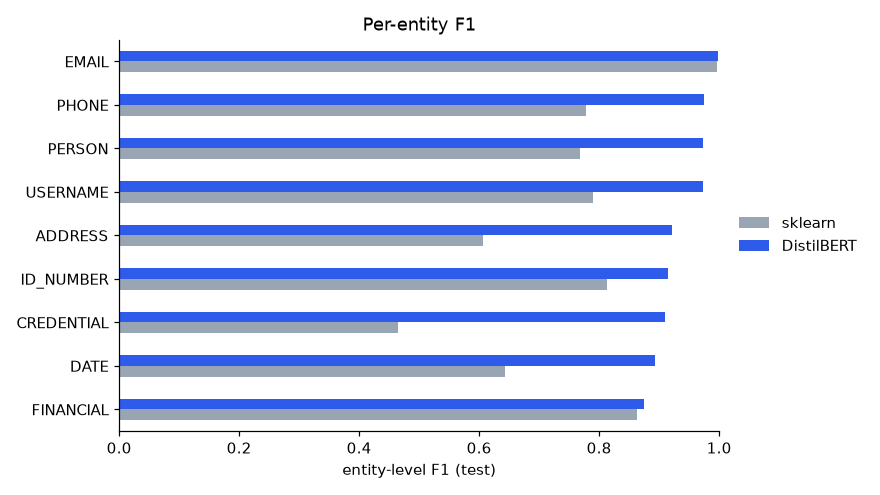
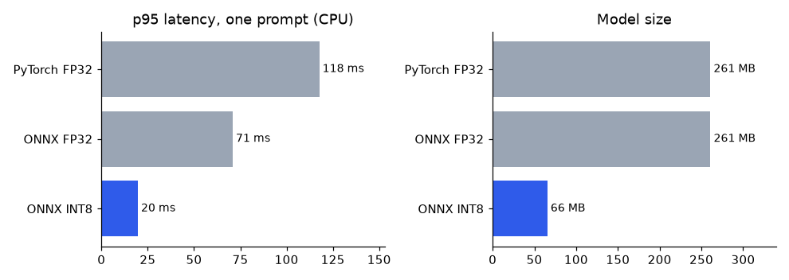
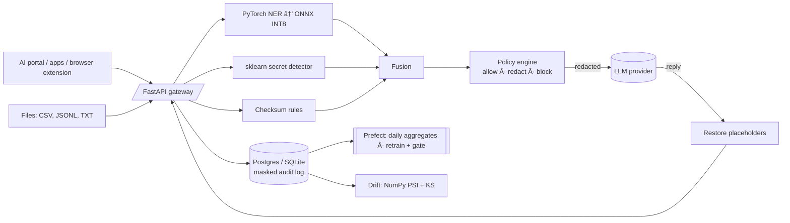

# PromptShield

**An ML gateway that stops personal data and secrets from leaking into LLMs.**

Employees paste customer records, API keys and internal data into ChatGPT, Claude and Copilot every day. PromptShield sits between users and any LLM. It detects sensitive data with a fine-tuned **PyTorch** NER model, a **scikit-learn** secret detector and checksum rules. Each request is then **allowed, redacted or blocked**. Redacted values are swapped for placeholders before the prompt leaves the company, and restored in the LLM's reply, so the user still gets a complete answer.

  

## Example

An analyst wants an LLM to summarise customer complaints:

```
Customer Rahul Mehta (rahul.mehta@example.com, +91 98765 43210) says the refund
to account 50100234567812 never arrived. Please summarise.
```

What actually leaves the company:

```
Customer [PERSON_1] ([EMAIL_1], [PHONE_1]) says the refund to account [FINANCIAL_1]
never arrived. Please summarise.
```

The LLM replies about `[PERSON_1]`, and PromptShield puts the real name back before the analyst sees it. A prompt containing an API key or password is **blocked** outright. Every decision is logged for compliance, with **no raw text stored**.

## Results

| | |
|---|---|
| **PII detection (DistilBERT, PyTorch)** | entity F1 **0.946** (P 0.932 / R 0.961) on held-out templates; the scikit-learn baseline scores 0.774 |
| **Secret detection (scikit-learn)** | F1 **0.917** with **precision 1.00** on an *out-of-distribution* set of unseen token formats and contexts |
| **Serving optimization** | ONNX INT8: **4× smaller** (261 → 66 MB) and **2.6–6× faster** on CPU (~20 ms p95 per prompt), no accuracy loss |
| **Calibration** | temperature scaling: ECE 0.0069 → **0.0023**, so confidences drive the policy and review thresholds |
| **Drift monitoring** | held-out traffic: all PSI < 0.08 (stable); code-heavy shifted traffic: PSI > 9 (alert) |
| **Load** | 34.9 req/s, 0 failures, single worker on a laptop (Locust, 20 users) |
| **Tests** | 67 tests: unit, data contracts, API, model regression (F1 floor, long-document recall, invariance, hard negatives) |

<p>
  
  
</p>

Every number is reproducible from `reports/*.json`. How they were reached, including the mistakes, is written up in [docs/decisions.md](docs/decisions.md).

## Architecture



| Layer | What's in it |
|---|---|
| **Data pipeline** (`src/promptshield/data`) | ingest public PII data → unify 17 source labels into 9 → compositional synthetic generator (Indian + international formats, fake secrets, hard negatives) → span-preserving NFKC cleaning → **pandera** validation → leakage-safe grouped split → Parquet, versioned with **DVC** |
| **Models** (`src/promptshield/models`) | hand-written PyTorch training loop (AMP, class weights, early stopping, temperature scaling) · sklearn `GridSearchCV` with grouped CV · ONNX export + INT8 quantization · benchmark |
| **Serving** (`src/promptshield/serving`) | FastAPI with Pydantic schemas, API-key auth, rate limiting, request IDs, JSON logs · sliding-window chunking for long documents · pluggable LLM providers (mock / Ollama / OpenAI-compatible) |
| **Storage** (`src/promptshield/db`) | SQLAlchemy models + Alembic migrations · masked events, feedback and scan jobs only |
| **Pipelines** (`src/promptshield/pipelines`) | Prefect flows: dataset build, daily aggregates, **retrain with regression gate and automatic rollback** · batch file scanning |
| **Monitoring** (`src/promptshield/monitoring`) | PSI and KS tests in NumPy, metrics API |
| **Dashboard** (`dashboard/`) | vanilla JS + Chart.js: playground, batch scan, review queue, monitoring |
| **Browser extension** (`extension/`) | Chrome MV3: warns or redacts when pasting into claude.ai / chatgpt.com |

## API

| Endpoint | Purpose |
|---|---|
| `POST /v1/scan` · `POST /v1/redact` | detect entities, or get the redacted text |
| `POST /v1/proxy/chat` | scan → policy → forward to the LLM → restore the reply |
| `POST /v1/scan/batch` · `GET /v1/jobs/{id}` | scan a file and report where sensitive data lives |
| `POST /v1/feedback` · `GET /v1/review-queue` | human-in-the-loop corrections |
| `GET /v1/metrics` · `GET /v1/drift` · `GET /v1/model-info` · `GET /v1/health` | operations |

Full reference: [docs/api.md](docs/api.md). Interactive docs are served at `/docs`.

## Quickstart

```bash
python -m venv .venv && .venv/bin/pip install -e ".[train,dev]"   # Windows: .venv\Scripts\pip
python -m promptshield.data.build               # data pipeline (downloads the public dataset)
python -m promptshield.models.secret_detector   # sklearn
python -m promptshield.models.ner_torch --epochs 5   # PyTorch (GPU recommended, ~18 min on an RTX 4050)
python -m promptshield.models.export_onnx       # ONNX + INT8
python scripts/build_drift_reference.py
uvicorn promptshield.serving.app:app --port 8000   # dashboard at http://localhost:8000
```

Or reproduce the whole pipeline with `dvc repro`. With Docker (API + Postgres):

```bash
docker compose up --build
```

```bash
pytest -q                                             # 67 tests
python scripts/drift_replay.py --mode shifted --n 300 # watch drift alerts fire
locust -f load_tests/locustfile.py --host http://localhost:8000
```

## Privacy by design

- The audit log stores a text hash, entity counts, confidences and latency. **It never stores text or values.**
- Placeholder maps live in memory for a single request.
- Batch reports contain counts and row/column locations only.
- Reviewer corrections are stored masked, then *rehydrated with fake values* for retraining. Real PII never enters training data.
- All synthetic secrets are generated at runtime; no key-shaped strings are committed.

## Documentation

- [Architecture](docs/architecture.md)
- [Engineering decisions and trade-offs](docs/decisions.md)
- [Model card](docs/model_card.md)
- [Data card](docs/data_card.md)
- [Runbook](docs/runbook.md)
- Notebooks: [EDA](notebooks/01_eda.ipynb), [model comparison](notebooks/02_error_analysis.ipynb)

## Limitations

English only. Context-free hex secrets look identical to hashes. Synthetic data cannot capture all real-world phrasing; the drift monitor and review queue exist to close that gap. Details are in the [model card](docs/model_card.md#limitations-and-risks).
