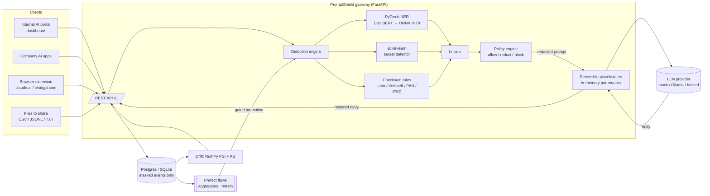

# Architecture

## Request path (`POST /v1/proxy/chat`)

1. **Validate**: Pydantic schema, API key, rate limit, size limit.
2. **Detect** (thread pool, CPU-bound):
   - The text is split into overlapping 512-token windows (`features/chunking.py`). A long prompt or file never gets truncated silently.
   - The ONNX INT8 NER model tags each window. Probabilities are temperature-calibrated, then decoded to character spans (`models/ner_common.py`).
   - The secret detector extracts candidates and scores their NumPy features (`features/secret_features.py`). The same module is used in training, so there is no train/serve skew.
   - Checksum rules find formats where a checksum gives certainty: Luhn for card numbers, Verhoeff for Aadhaar-style IDs.
   - Fusion resolves overlaps. Secrets and financial/ID matches win over generic labels, then the higher score wins.
3. **Policy** (`configs/policies.yaml`): an action per label, with per-team overrides. Any `block` label blocks the whole request.
4. **Redact**: values become `[LABEL_n]` placeholders. One map is shared across the conversation, so the same person always gets the same placeholder.
5. **Forward** only the redacted messages to the provider.
6. **Restore** placeholders in the reply before returning it.
7. **Audit**: a SHA-256 of the text, entity counts, confidences, action, latency and model version are written to SQL. Raw text and values are never written. Low-confidence requests also store a masked preview for the review queue.

## Data and model pipeline

| Stage | Code | Output |
|---|---|---|
| Ingest public PII data | `data/ingest.py` | ai4privacy English rows |
| Unify labels | `data/label_map.py` + `configs/label_map.yaml` | 9 NER labels |
| Synthetic data | `data/synth.py` | Indian formats, fake secrets, hard negatives |
| Clean | `data/clean.py` | NFKC with span re-alignment, dedupe, template hash |
| Validate | `data/validate.py` (pandera) | schema, span and label checks |
| Split | `data/split.py` | grouped by template (no leakage) |
| Train | `models/secret_detector.py`, `models/sk_token_baseline.py`, `models/ner_torch.py` | artifacts + metrics JSON |
| Optimize | `models/export_onnx.py`, `models/benchmark.py` | ONNX FP32/INT8 + benchmark |
| Orchestrate | `dvc.yaml`, `pipelines/flows.py` | reproducible runs; Prefect flows |

## Feedback loop

1. A reviewer submits a correction to `POST /v1/feedback`.
2. The example is masked with the **corrected** labels (`pipelines/feedback.py`).
3. When the `retrain` flow runs, the masked example is **rehydrated** with fresh fake values. This gives labelled training rows with exact spans, and no real PII is ever stored.
4. Retrain, then the regression gate (`configs/thresholds.yaml`) decides: promote the new model, or restore the backup of the live model.
